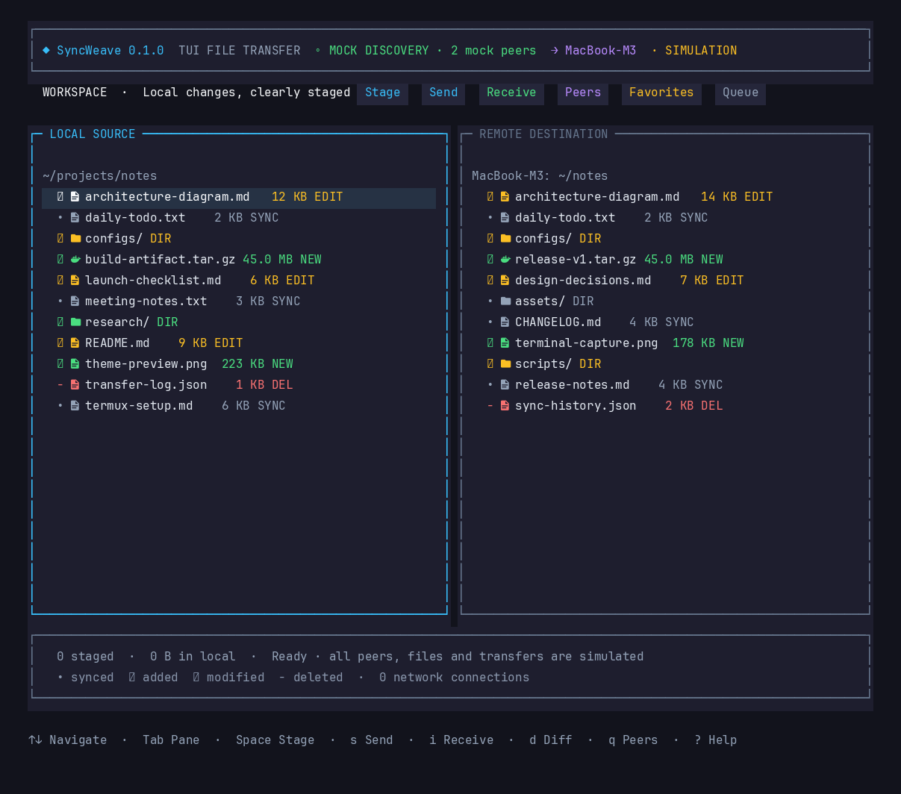
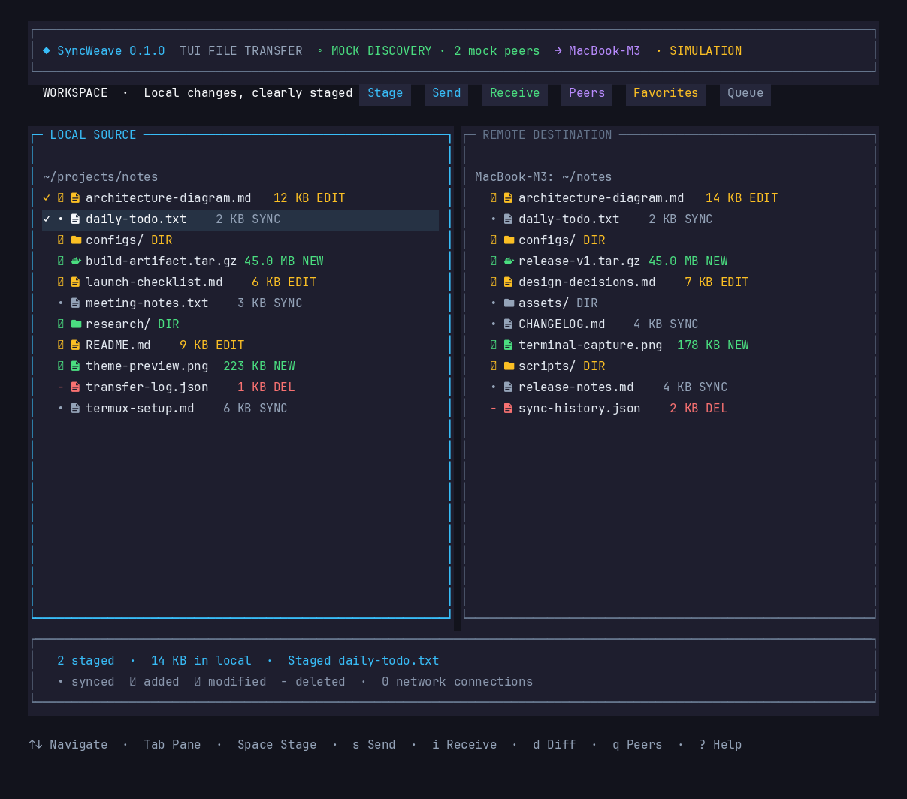
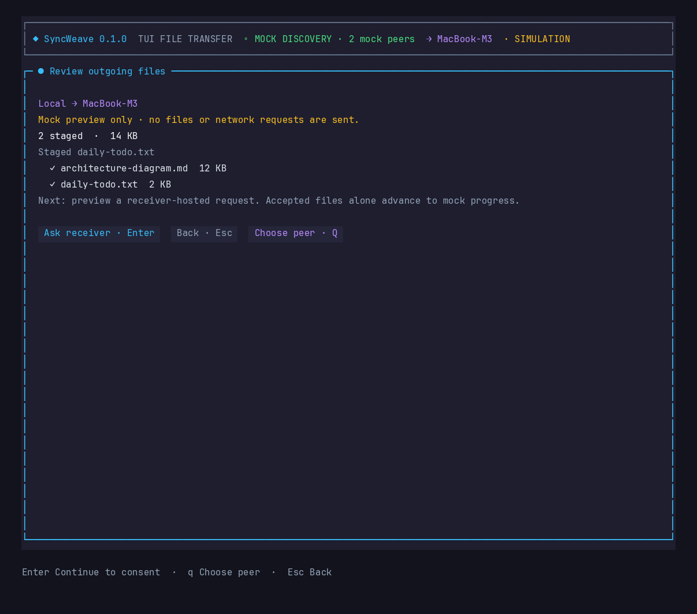
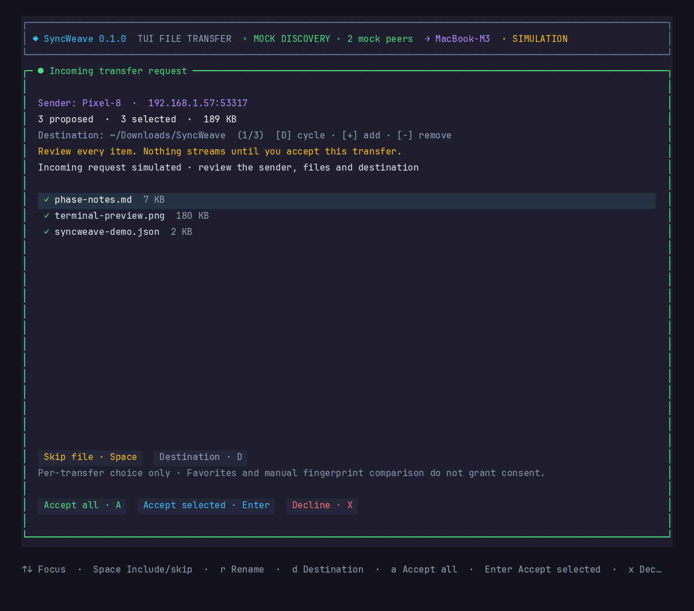
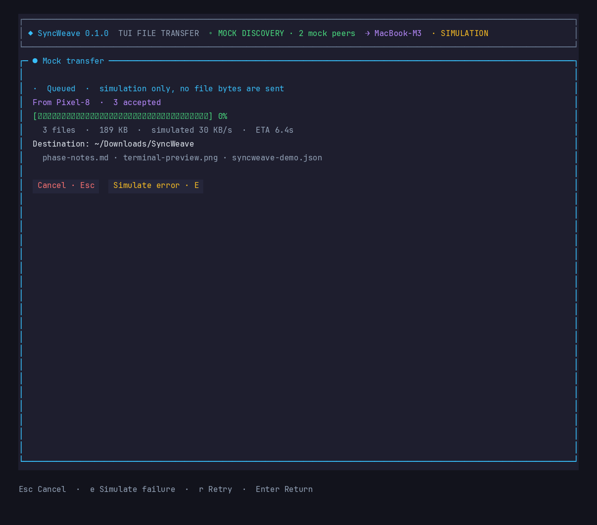
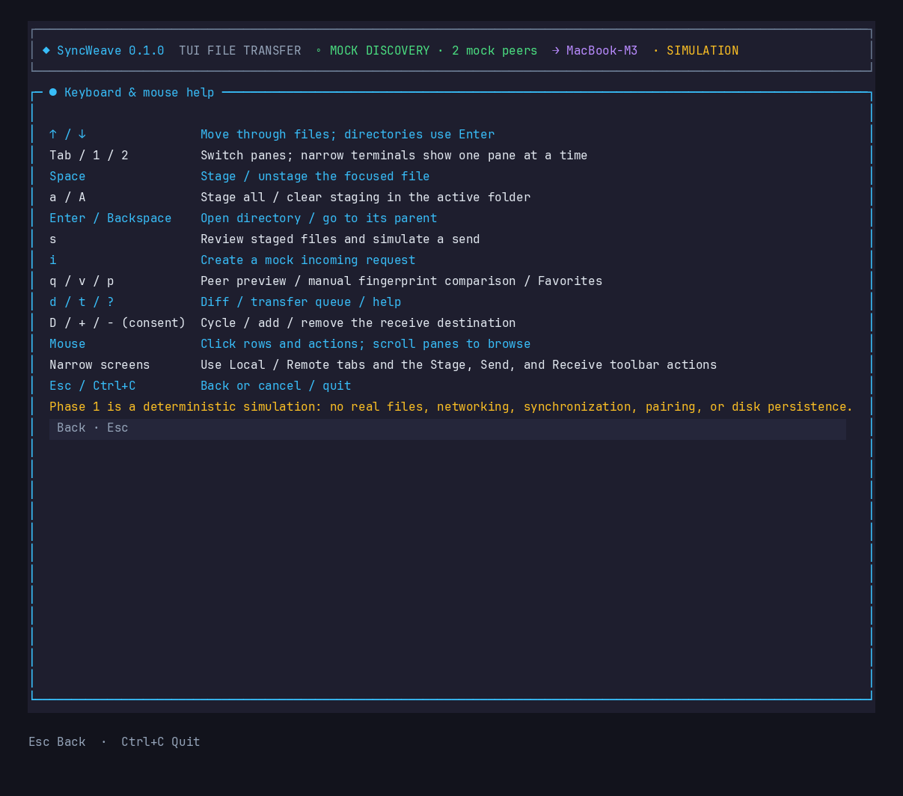

# SyncWeave

**Send files to the computer next to you — no cloud, no accounts, no setup.** SyncWeave is a keyboard-first terminal app for moving files across your local network, in the spirit of LocalSend. Pick files, pick a peer, compare a short security code, and the bytes flow directly between machines over Noise-encrypted TCP.



## How it works

1. **Browse** your files in a two-pane view. `Space` stages what you want to send.
2. **Pick a peer** — discovered automatically on the LAN, or added by hand.
3. **Compare the security code** shown on both screens, out loud or in person.
4. **Send.** The receiver approves each transfer on a consent screen first.

Nothing ever leaves your network. There are no servers, no accounts, and no telemetry.

## Screenshots

### Workspace — stage files, choose a peer

The local pane shows your files; the remote pane shows the selected peer. Staged files are highlighted and tallied at the bottom.



### Send review — confirm before anything moves

Review exactly what will go out and to whom. In real mode this is also where both sides compare the security code before any file names cross the wire.



### Consent — nothing arrives uninvited

Every incoming transfer waits for your explicit approval. You see the sender, the file list, the destination, and the security code — accept all, accept a subset, or decline. You have 60 seconds to decide.



### Transfer — per-file acknowledgement

The sender only reports success when the receiver acknowledges each file with a matching hash and size. Name collisions never overwrite: the second copy becomes `name (1).ext`.



### Help — every key, one screen away

Press `?` anywhere.



> Screenshots were captured from the app's own test renderer — real frames, real theme, real Nerd Font icons. Mock mode is shown; the layout is identical in real mode.

## Modes

- **Mock** (default): a deterministic simulation for exploring the UI. No files are read, nothing touches the network.
- **Real** (`--real`): actual file transfers between SyncWeave instances over TCP, encrypted with `Noise_XX_25519_AESGCM_SHA256`. Peers are found by UDP multicast, or added manually with `--peer host:port`.

## Status

SyncWeave is **0.1.0, pre-release, and not production-ready.** No tagged release exists yet.

**Implemented and covered by automated tests** (Linux, in-process loopback):

- Noise XX handshake, checked against the official `Noise_XX_25519_AESGCM_SHA256` test vectors, and protocol v2 framing.
- Send, accept, decline, cancel and receiver failure over real TCP sockets.
- Per-file acknowledgement: the sender reports success only when the receiver acknowledges each file with a matching hash and size.
- Receiver consent for every transfer, with a security code shown on both ends.
- Collision handling: a second file with the same name is saved as `name (1).ext`. Existing files are never overwritten.
- Partial files are created exclusively with mode `0600` and are removed on failure.
- Friendly message when the TCP port is already in use.

**Unverified:**

- Two physical hosts on a real LAN. The [real-mode checklist](docs/real-mode-checklist.md) has not been run on hardware.
- Multicast discovery across real routers and access points.
- macOS. CI has a macOS job, but it has not run yet.
- Termux and Android.
- Throughput, memory and CPU under load.

**Known limitations** (full list in [docs/known-limitations.md](docs/known-limitations.md)):

- No retries and no resume. A failed or cancelled transfer must be sent again from the beginning.
- Discovery names are unauthenticated. Anyone on the LAN can claim any name, so compare the security code.
- Sender concurrency is not capped.

## Requirements and install

- [Bun](https://bun.sh/) **1.4.3**, the version in [`.bun-version`](.bun-version) and used by CI. The package declares `engines.bun >=1.4.0`.
- A Unicode-capable terminal. For terminals without Nerd Fonts, set `SYNCWEAVE_ASCII=1`.

```sh
git clone https://github.com/Theblackcat98/SyncWeave.git
cd SyncWeave
bun install
bun run dev        # run from source, reloads on change
bun run start      # run from source
```

Release binaries for `linux-x64`, `linux-arm64` and `darwin-arm64` are built by the release workflow when a `v*` tag is pushed. No tag has been published yet, so build from source for now.

Reduced motion for the decorative animation: `SYNCWEAVE_REDUCED_MOTION=1`.

## Real mode

Run with `--real`. Two machines on the same LAN find each other by multicast:

```sh
# machine A
bun src/main.ts --real --alias laptop1
# machine B
bun src/main.ts --real --alias laptop2
```

Flags accept both `--flag value` and `--flag=value`. Environment variable `SYNCWEAVE_MODE=real` is the same as `--real`.

| Flag | Default | Meaning |
|---|---|---|
| `--real` | off | Real mode: TCP listener, discovery and the real filesystem. |
| `--alias <name>` | random label, new each run | Name shown to peers. It is not your username. It is visible to everyone on the LAN. |
| `--port <n>` | `24816` | TCP port for the listener, 1 to 65535. |
| `--bind <addr>` | `::` | Address to listen on. Without `--bind`, SyncWeave falls back to `0.0.0.0` if IPv6 is unavailable and shows a notice. An explicit `--bind` never falls back. Use `127.0.0.1` to stay off the LAN. |
| `--peer <host[:port]>` | none | Manual peer, repeatable. Port defaults to `24816`. Wrap IPv6 in brackets: `--peer [::1]:24816`. |
| `--root <dir>` | your home directory | Directory the local file browser opens in. |
| `-h`, `--help` | | Print usage and exit 0. |
| `--version` | | Print the version and exit 0. |

Unknown flags, a missing value, or an invalid port or `--peer` value print a message and exit with status 2. Runtime failures exit with status 1.

### Two instances on one machine

Each instance needs its own port and must point at the other, because multicast may not loop back on one host:

```sh
bun src/main.ts --real --alias laptop1 --port 24816 --peer 127.0.0.1:24818
bun src/main.ts --real --alias laptop2 --port 24818 --peer 127.0.0.1:24816
```

### Sending

1. Browse your files. Press `Space` to stage a file.
2. Press `Tab` to the Receiver pane and use `↑`/`↓` to pick a peer. Press `Tab` to go back.
3. Press `s`, then `Enter`.
4. Both people compare the **security code**. The sender confirms it before any file names or sizes are sent. The receiver confirms it on the consent screen.

### Receiving

The consent screen shows the sender's name, the file names, the sizes and the security code. Choose a destination, then:

- `a` accepts all files.
- `Enter` accepts the selected files.
- `x` declines.

You have **60 seconds** to answer. The sender waits up to **75 seconds** for acceptance. Accepted files are saved to the destination, which defaults to `~/Downloads`. The destination picker refuses symlinks, system directories, hidden (dot) directories and world-writable directories.

**Security code and identity.** A sender's name shown on a discovery list is a claim, not proof of identity. Compare the security code with the other person in person or over a call before you accept anything sensitive. There is no pairing and no trust-on-first-use: every transfer needs its own comparison. Peer IDs are random per process and are never stored.

**Startup cleanup.** At startup SyncWeave removes leftover `.syncweave-*.partial` files only when the process that created them is no longer running. Partials from a second instance that is still running are left alone.

## Mock mode

Mock mode runs the simulated workflow. No files are read or sent.

- Browse with `↑`/`↓`. Use `Tab`, `1` or `2` to change panes. `Enter` opens a folder and `Backspace` goes up.
- `Space` stages a file. `a` stages all files in the folder. `Shift+A` clears staging for the folder.
- `s` reviews outgoing items. Each simulated receive asks for consent. `i` simulates an incoming request.
- `e` simulates a failure during progress. `r` retries. `Esc` cancels.
- `q` lists mock peers. `v` shows a fingerprint for comparison, which is not stored as verification. `f` saves a local Favorite, which is a destination shortcut and not trust. `t` shows session history. `?` shows help.

Mouse clicks and wheel scrolling work where the terminal reports mouse input.

## Project layout

- `src/main.ts`: entry point. Parses flags, starts real or mock services, and handles signals.
- `src/cli-args.ts`: flag parsing and validation.
- `src/app.ts`: keyboard and mouse routing and the workflow state machines for mock and real modes.
- `src/domain.ts`, `src/state/`: typed state and transfer contracts.
- `src/peer-sync.ts`, `src/cursor.ts`, `src/theme.ts`: helpers for peers, cursors and colours.
- `src/services/`: real and simulated services.
  - Real: `transport.ts` (TCP listener and dialer), `noise.ts` (Noise XX), `frame-parser.ts` (framing and size caps), `transfer-protocol.ts` (send and receive protocol), `session-auth.ts` (identity proofs and SAS), `peer-id.ts`, `discovery.ts` (UDP multicast), `safe-receive-sink.ts` (writes received files), `real-filesystem.ts`, `destinations.ts` (destination picker), `ports.ts`, `friendly-errors.ts`, `diagnostic-log.ts`.
  - Simulated and placeholder: `mock-filesystem.ts`, `mock-peer-service.ts`, `mock-transfer-service.ts`, `null-services.ts`.
- `src/ui/`: OpenTUI rendering, primitives, transfer presentation and `animation-clock.ts`.
- `docs/`: networking, decisions, checklists, privacy, troubleshooting, known limitations and release gates. Old phase documents are in `docs/history/`.

## Checks

```sh
bun run lint        # Biome, lint only
bun run typecheck   # tsc --noEmit
bun test            # full suite
bun run test:coverage   # runs coverage and enforces the floors in scripts/check-coverage.ts
bun run smoke       # headless UI smoke test
bun audit           # dependency vulnerability check
```

CI runs lint, typecheck, coverage and `bun audit` on `ubuntu-latest` and `macos-latest`. The macOS job has not run yet. The headless UI tests cover the wide and narrow layouts, keyboard navigation, mouse actions, consent before progress, completion, reduced motion, failure and retry, peer timeout and retry, Favorites and fingerprint comparison. Termux and touch behaviour still need testing on a real Android terminal.

## Documentation

- [docs/networking.md](docs/networking.md): transports, protocol, security properties and firewall notes.
- [docs/decisions.md](docs/decisions.md): recorded decisions and their status.
- [docs/real-mode-checklist.md](docs/real-mode-checklist.md): manual test steps for real mode.
- [docs/troubleshooting.md](docs/troubleshooting.md): common failures and what to check.
- [docs/known-limitations.md](docs/known-limitations.md): what does not work yet.
- [docs/privacy.md](docs/privacy.md): what is visible on the LAN and what is written to disk.
- [docs/release-gates.md](docs/release-gates.md): release gates with evidence.
- [SECURITY.md](SECURITY.md) and [CHANGELOG.md](CHANGELOG.md).
- [docs/history/](docs/history/): the Phase 1 and Phase 2 planning documents, archived. They are not current.

## License

MIT. See [LICENSE](LICENSE).
